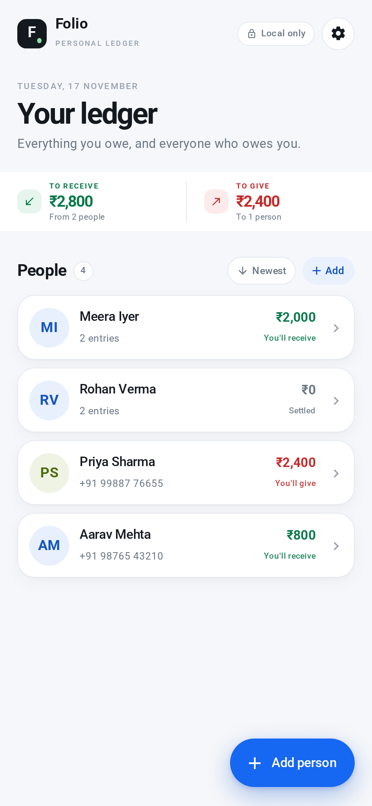
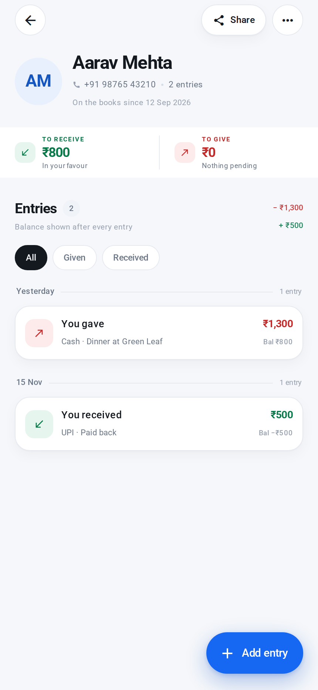
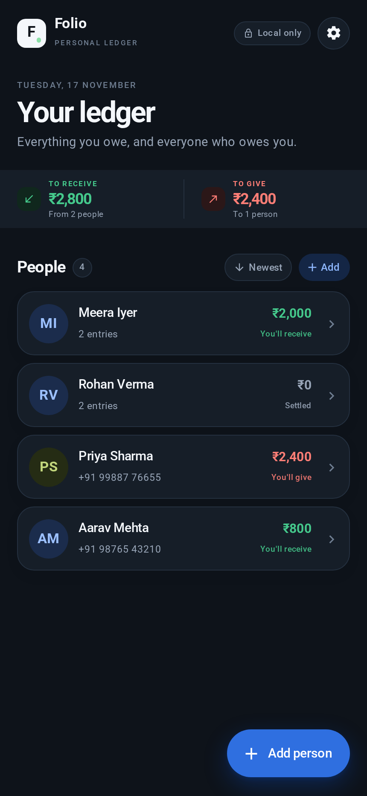
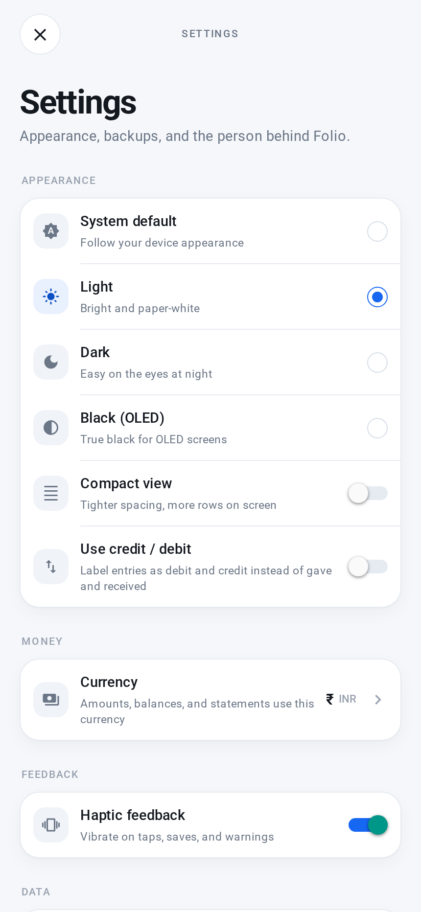

<div align="center">
  

  <h1>Folio</h1>

  <p><strong>A private credit &amp; debit ledger for people, not spreadsheets.</strong></p>

  <p>
    Track who owes you, who you owe, and every entry in between — entirely on your device.
  </p>

  <p>
    <a href="https://github.com/munsif-solkar/folio/releases/latest">
      
    </a>
  </p>

  <p>
    
    
    
    
  </p>
</div>

> **Local-first by design.** No sign-up, no cloud sync, no analytics, no tracking. Your ledger stays on your device unless you choose to export or share it.

## Screenshots

<table>
  <tr>
    <td align="center"><br /><sub>Your ledger at a glance</sub></td>
    <td align="center"><br /><sub>Every entry, every balance</sub></td>
  </tr>
  <tr>
    <td align="center"><br /><sub>Light, dark, and OLED themes</sub></td>
    <td align="center"><br /><sub>Make it yours</sub></td>
  </tr>
</table>

## Why Folio

Most money apps are built for banks and budgets. Folio is built for the small, messy, human ledger: the dinner you covered, the tickets someone split, the ₹500 that came back in cash.

It keeps a running balance per person, so the answer to “where do we stand?” is always one tap away.

## Features

- **Person-first accounts** — every person has their own ledger with running balance, total given, total received, and account age.
- **One-tap entry sheet** — amount, direction, date, optional payment method and note.
- **Running balances** — the balance after every entry is shown inline, not just the final total.
- **Home dashboard** — total receivables and payables, plus a sortable people list (newest or oldest added first).
- **Share a snapshot** — a clean PNG with name, balance, and key figures, ready for WhatsApp.
- **Full PDF statement** — every entry, date, note, method, and running balance in one document.
- **Sensible file names** — exports include the person and date, e.g. `Folio-Aarav-Mehta-17-11-2026.pdf`.
- **Currency support** — INR by default, plus USD, EUR, GBP, AED, SGD, AUD, CAD, and JPY.
- **Your words** — choose simple “You gave / You received” or professional “Debit / Credit” terminology.
- **Themes that fit** — System, Light, Dark, and true-black OLED, with an optional compact layout.
- **Haptics on your terms** — subtle feedback for taps and saves, with a switch to turn it off.
- **JSON backup & restore** — export the whole ledger and import it on another device.
- **No account required** — open the app and start writing.

## Download

### Android

Grab **`folio-universal.apk`** from the [latest release](https://github.com/munsif-solkar/folio/releases/latest).

The universal APK includes all supported architectures, so it installs on phones, tablets, and emulators. Android may ask you to allow installing from your browser or file manager the first time.

### Web

Folio also runs as a web app through Expo's web target. Start it locally with the steps below. There is no hosted demo yet.

## Run locally

**Prerequisites:** Node.js 20 or newer (the project is developed on Node 24), npm, and Git.

```bash
git clone https://github.com/munsif-solkar/folio.git
cd folio
npm install
npm run web
```

Or start the Expo dev server and choose a target:

```bash
npx expo start
```

To build a local native app instead of using Expo Go:

```bash
npx expo run:android
```

`ios/` and `android/` are generated by Expo Continuous Native Generation. They are not committed, so configure native behaviour in `app.json` or a config plugin rather than editing those folders.

## Build

The project is linked to EAS. To produce a shareable Android APK:

```bash
npx eas-cli@latest build --platform android --profile preview
```

The `production` profile builds an Android App Bundle (`.aab`) for store distribution. The `preview` profile builds the universal APK attached to releases.

Useful checks before shipping:

```bash
npm run typecheck
npm run lint
npx expo-doctor
```

## Tech stack

| Layer | Choice |
| --- | --- |
| App framework | [Expo](https://expo.dev) SDK 58 |
| Runtime | React Native 0.88 + React 19 |
| Navigation | [Expo Router](https://docs.expo.dev/router/introduction/) |
| Language | TypeScript (strict) |
| Storage | AsyncStorage, versioned local JSON |
| Documents | `expo-print` (native) / `jsPDF` (web) |
| Snapshots | `react-native-view-shot` / `html2canvas-pro` |
| Builds | EAS Build |

## Project structure

```text
src/
  app/                 Expo Router screens
    index.tsx          Home: totals and people
    person/[id].tsx    Person account and entries
    new-person.tsx     Add a person
    settings.tsx       Appearance, money, data, developer
  components/          UI primitives, sheets, calendar, KPI strip
  lib/
    store.tsx          Ledger state and AsyncStorage persistence
    theme.tsx          Theme, layout, and user preferences
    format.ts          Money, date, and balance formatting
    currency.ts        Currency metadata
    statement.ts       Statement model and HTML
    export-statement*  PDF generation for native and web
    share-snapshot*    PNG snapshot generation
assets/                Icons, splash art, embedded fonts
docs/screenshots/      README screenshots
```

## Data & privacy

Folio stores everything locally:

- `folio.ledger.v1` — people and entries
- `folio.settings.v1` — theme, currency, terminology, and feedback preferences

Nothing is uploaded. Sharing a statement or snapshot creates the file on the device and hands it to the system share sheet — that step is always initiated by you. Backups are plain JSON, so treat exported files like any other personal document.

## Contributing

Issues and pull requests are welcome. For larger changes, open an issue first so the direction can be discussed. Please run typecheck and lint before opening a PR.

- Report a bug: [GitHub Issues](https://github.com/munsif-solkar/folio/issues)
- Source: [github.com/munsif-solkar/folio](https://github.com/munsif-solkar/folio)

## Developer

Designed and built by **Munsif Solkar** · [@munsif_solkar](https://github.com/munsif-solkar)

## License

[MIT](LICENSE) © 2026 Munsif Solkar
